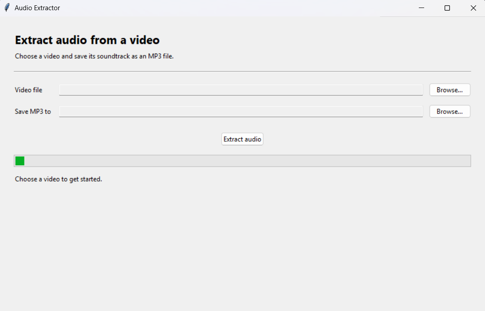

# Video Audio Extractor

A desktop app that extracts a video's audio track to an MP3 file using Python and MoviePy.

## Preview



## Run

Install MoviePy:

```powershell
python -m pip install moviepy
```

Start the app:

```powershell
python main.py
```

In the window, browse for a video, choose where to save the MP3 (the default is
next to the video), then click **Extract Audio**. The app supports common video
formats such as MP4, MOV, AVI, MKV, and WebM.
